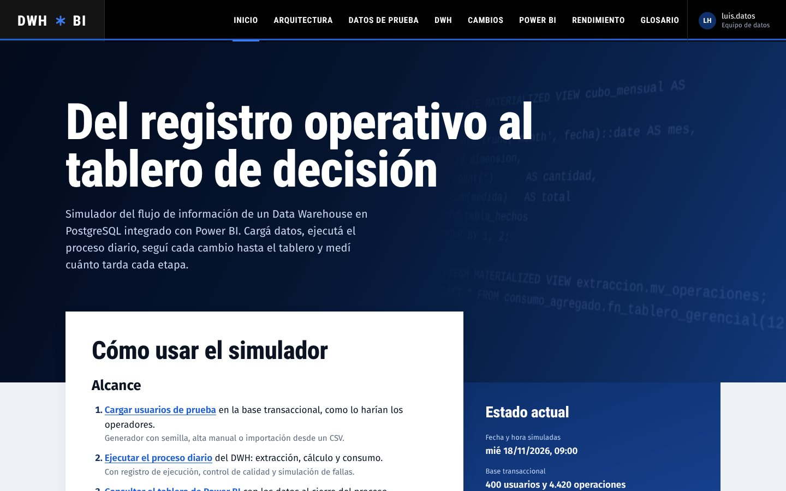
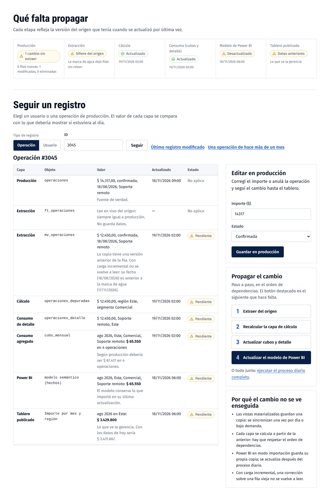
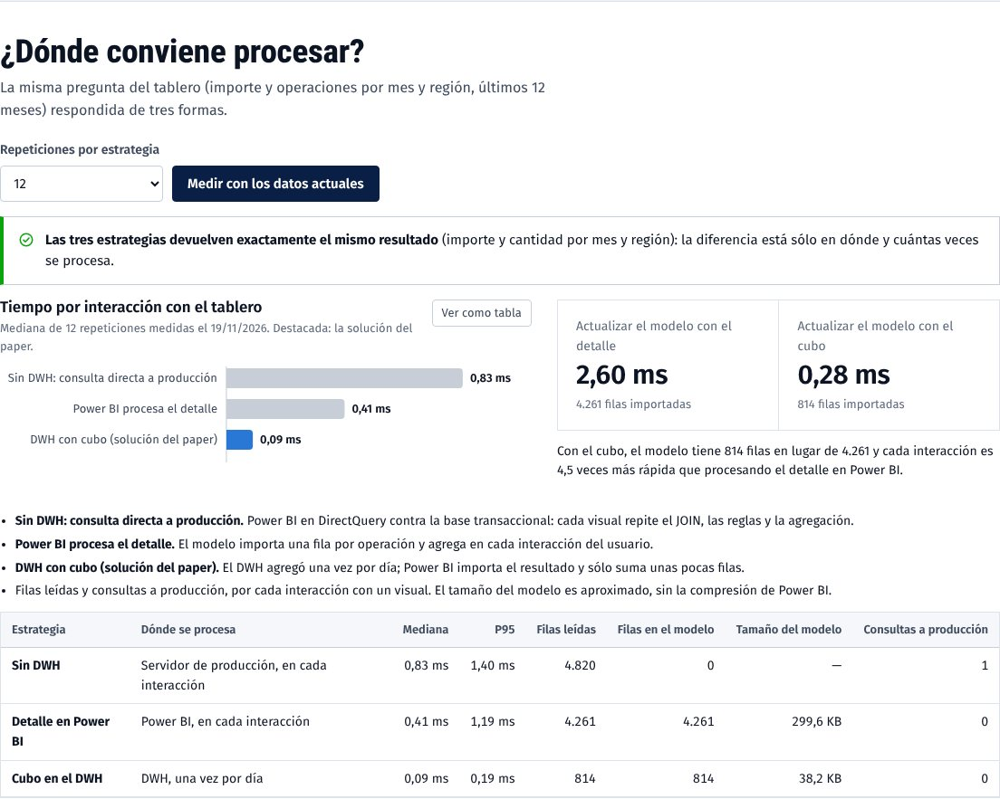

# Simulador del flujo de información DWH → Power BI

Sistema web que muestra, funcionando, el flujo descrito en el paper **«Del registro operativo al tablero de decisión: arquitectura y flujo de información de un Data Warehouse integrado con Power BI»**: desde la carga manual de datos en la base transaccional hasta los tableros publicados para las gerencias.

Permite **cargar usuarios de prueba**, **ejecutar el proceso diario del DWH**, **editar un dato y ver cómo se refleja** capa por capa y **medir el rendimiento** de cada estrategia de procesamiento.



> Todos los datos son ficticios y la organización está anonimizada: el simulador reproduce la arquitectura, no la estructura ni los datos de ninguna organización real.

## Qué se puede hacer

| Sección | Qué muestra |
|---|---|
| **Arquitectura** | El diagrama del flujo (Figura 1 del paper), interactivo y con los datos del momento. Las capas del DWH (Tabla 1), la separación de servidores y los perfiles de acceso. |
| **Datos de prueba** | La base transaccional. Generador de usuarios de prueba con semilla (hasta 25.000 usuarios y 250.000 operaciones), alta manual, importación desde CSV, edición y planilla de metas del repositorio de archivos. |
| **DWH** | El proceso diario: tablas foráneas, vistas materializadas, cálculo, cubos y detalle, actualizados en orden de dependencias. Incluye el registro de ejecución, el control de calidad, la simulación de fallas (origen caído, gateway fuera de línea), la carga completa o incremental y un laboratorio para crear cubos nuevos. |
| **Cambios** | Seguimiento de un registro: cuánto vale en producción, en cada capa del DWH, en el modelo de Power BI y en el tablero publicado, y qué falta propagar. |
| **Power BI** | Un tablero gerencial alimentado por el modelo importado: indicadores, gráficos con su vista de tabla, filtros, Power Query (M) y medidas DAX. |
| **Rendimiento** | Mediciones de tiempo: duración de cada paso del proceso, comparación de tres estrategias, escalabilidad según el volumen, carga completa frente a incremental y carga que recibiría producción sin DWH. |
| **Glosario** | Términos del flujo y SQL de PostgreSQL comentado para cada etapa. |

### Recorrido sugerido para una demostración

1. En **Datos de prueba**, generá 1.000 usuarios de prueba.
2. En **Cambios**, mirá cómo ninguna capa del DWH los ve todavía.
3. Propagá el cambio paso a paso, o ejecutá el proceso diario desde **DWH**, y comprobá que llega al tablero.
4. Activá la carga incremental, corregí el importe de una operación vieja y ejecutá el proceso: el control de calidad detecta la diferencia.
5. En **Rendimiento**, medí las tres estrategias y la escalabilidad.

| Seguimiento de un cambio | Comparación de estrategias |
|---|---|
|  |  |

## Relación con el paper

| Paper | Dónde se ve en el simulador |
|---|---|
| 2. Visión general del flujo (cinco etapas, fuente complementaria) | Inicio y Arquitectura |
| 3.1. Organización en capas (Tabla 1) | Arquitectura y DWH |
| 3.2. Extracción: tablas foráneas y vistas materializadas | DWH → capa de extracción; vista previa de una tabla foránea que consulta al origen |
| 3.3. Transformación y cubos; orden de dependencias | DWH → cálculo y consumo; "Actualizar con dependencias" |
| 3.4. Automatización y monitoreo (registro de ejecución) | DWH → Registro de ejecución y notificaciones |
| 4. Consumo desde Power BI, gateway, sólo lectura | Power BI; perfiles de acceso |
| 5.2. Creación de un nuevo cubo ("reutilizar antes de extraer") | DWH → Laboratorio de cubos |
| 6. Ventajas | Inicio → "Ventajas que se pueden comprobar" |
| 8. Limitaciones y trabajos futuros (medir tiempos, carga incremental, monitoreo, calidad de datos) | Rendimiento, control de calidad y modo incremental |

## Cómo funciona por dentro

El sitio es **estático y no tiene dependencias**: HTML, CSS y JavaScript con módulos nativos. Todo corre en el navegador.

- **Motor de simulación** (`public/js/motor/`): JavaScript puro, sin acceso al DOM, probado con el *test runner* de Node.
  - `estado.js`: la base transaccional (`usuarios`, `operaciones`) con validaciones que imitan sus restricciones, como la clave foránea.
  - `dwh.js`: el catálogo de objetos del DWH, el proceso diario, el registro de ejecución y la conciliación.
  - `powerbi.js`: el modelo semántico en modo importación y las consultas de los visuales.
  - `rendimiento.js`: las mediciones.
  - `cubos.js`: el laboratorio de cubos.
  - `sql.js`: el SQL de PostgreSQL de cada objeto.
- **Versiones**: cada cambio en producción sube la versión de su tabla. Cada objeto del DWH recuerda qué versión del origen refleja, y así se sabe qué está desactualizado y por qué.
- **Mediciones**: cada prueba se repite y se informa la mediana y el percentil 95. Las operaciones muy rápidas se miden en lotes. Cuando una fila pasa de un servidor a otro (del origen al DWH por el *foreign data wrapper*, o del DWH a Power BI por el gateway) se serializa, como viajaría por la red. Los tiempos sirven para comparar estrategias con los mismos datos; en PostgreSQL los valores absolutos son otros.
- **Persistencia**: el estado se guarda en el navegador (IndexedDB). Cada persona que abre el sitio tiene su propia copia, y el botón *Restablecer la demostración* vuelve al escenario inicial.
- **Interfaz** (`public/js/vistas/`, `public/js/ui/`): una vista por sección, con enrutamiento por `#/ruta` y gráficos SVG propios. Cada gráfico tiene su vista de tabla y se puede usar con teclado.

```
├── netlify.toml            # configuración del sitio en Netlify
├── package.json            # scripts: npm start, npm test (sin dependencias)
├── public/                 # lo que se publica
│   ├── index.html
│   ├── css/estilos.css
│   ├── fuentes/            # Roboto y Fira Sans (licencia OFL)
│   └── js/
│       ├── app.js          # navegación, enrutador y pie
│       ├── tienda.js       # estado global y guardado en IndexedDB
│       ├── motor/          # simulación del flujo (sin DOM)
│       ├── ui/             # componentes, gráficos y utilidades
│       └── vistas/         # una por sección
├── scripts/servidor.mjs    # servidor local mínimo
├── tests/motor.test.mjs    # pruebas del motor
└── docs/capturas/          # imágenes de este documento
```

## Ejecutarlo en tu computadora

Requiere [Node.js](https://nodejs.org/) 20 o superior. No hay que instalar paquetes.

```bash
npm start      # abre el simulador en http://localhost:8080
npm test       # corre las pruebas del motor
```

También funciona con cualquier servidor estático que sirva la carpeta `public/`. Abrir `index.html` con doble clic no alcanza, porque los módulos de JavaScript necesitan un servidor.

## Publicarlo en Netlify

La configuración ya está en `netlify.toml`: carpeta de publicación `public`, sin compilación, con encabezados de seguridad. Antes de cada despliegue se corren las pruebas: si alguna falla, Netlify no publica.

1. Entrá a [app.netlify.com](https://app.netlify.com/) e iniciá sesión con GitHub.
2. Elegí **Add new site → Import an existing project → GitHub** y seleccioná `MatiasVel/flujo_de_informacion_dwh`.
3. Netlify toma la configuración de `netlify.toml`, así que no hace falta completar nada. Tocá **Deploy**.
4. Cada *push* a `main` vuelve a publicar el sitio, y cada *pull request* genera una vista previa propia.

Con la CLI de Netlify también se puede publicar desde la computadora: `npx netlify-cli deploy --prod --dir=public`.

## Alcance y limitaciones

- Es un simulador educativo: no se conecta a un PostgreSQL ni a un Power BI reales. El SQL, el Power Query y el DAX que muestra son ejemplos genéricos y comentados.
- Los perfiles de acceso simulan los permisos del paper (operador, equipo de datos y gerencia de sólo lectura). No son un control de seguridad y no usan contraseñas.
- Los tiempos se miden en el navegador de quien usa el sitio y dependen de su computadora.

## Créditos

- Tipografías [Roboto](https://fonts.google.com/specimen/Roboto) y [Fira Sans](https://fonts.google.com/specimen/Fira+Sans), bajo SIL Open Font License (ver `public/fuentes/`).
- Referencias bibliográficas: las del paper, listadas en la sección Glosario del simulador.
